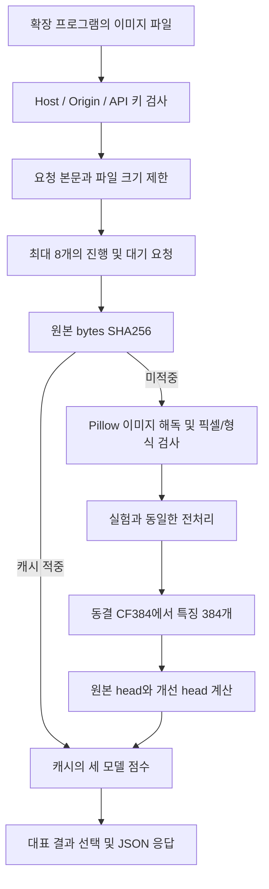

# 서버 내부 동작과 모델 원리

2026-11-19: API 1.2.0의 기본 대표 결과는 `lowres`다. 임계값 0.5와 기존 가중치는 동일하다. 실제 웹 썸네일 평가는 [작업 요약](WORK_SUMMARY_KO.md)에 정리했다.

2026-11-18 추가: 기존 구성에 160~300px 축소 학습 head를 추가했다. `model=lowres`로 선택하며 기존 두 head는 보존한다. 세 head는 아래 CF 특징 f를 공유하고 추가로 `sigmoid(w_lowres·f+b_lowres)`를 계산한다. 자세한 변경과 재평가한 수치는 `LOWRES_UPDATE.md`를 본다. 기존 2개 head에 대한 아래 설명은 그대로 유효하지만 응답에는 `lowres`도 들어간다.

## 1. 시작 시 한 번 수행

`run_server.py`가 API 키를 읽거나 처음 생성한다. 기본으로 127.0.0.1에 바인딩하므로 같은 컴퓨터에서 접속한다. FastAPI lifespan에서 아래를 실행한 뒤 HTTP 요청을 받는다.

1. 원본 가중치와 개선 head 존재 여부, 각각의 SHA256 확인.
2. `timm`의 `vit_small_patch16_384.augreg_in21k_ft_in1k` 생성(`pretrained=False`).
3. 로컬 safetensors의 `vit.` 접두어를 제거하고 `strict=True`로 전체 state_dict 로드.
4. `eval()`/`requires_grad_(False)` 적용. 서버는 학습하지 않는다.
5. 개선 head의 계수 384개와 편향 1개를 로드.
6. 선택 장치로 이동, 한 개의 추론 슬롯과 결과 캐시 초기화.

모델 다운로드는 서버 요청 경로에서 발생하지 않는다. 설치/파일 복원은 별도 준비 단계다. 여러 worker를 띄우면 메모리에 모델이 복제되고 캐시/대기열도 따로 생기므로 기본은 worker 1개다.

## 2. 요청별 처리



현재 요청은 업로드 파일 1개다. 서버가 이미지 URL을 대신 다운로드하지 않으므로 임의 URL fetch/쿠키 전달 기능은 없다. 확장 프로그램은 별도로 해당 사이트에서 이미지 원본 bytes를 확보해야 한다.

업로드는 최대 10MiB, 요청 전체는 여기에 multipart 여유 512KiB를 더한 한도다. Content-Length가 없더라도 실제 수신 bytes를 세어 중단한다. 파일이 이미지인지 확장자/MIME만 믿지 않고 Pillow로 확인한다. 최대 40MP, 단일 프레임/페이지만 허용한다.

## 3. 전처리의 정확한 의미

1. EXIF orientation을 픽셀에 반영한다.
2. RGB로 변환한다. 투명도/CSS 배경/사이트 필터를 합성하는 렌더링 모델은 아니다.
3. 원본 전체를 512×512로 bilinear 리사이즈한다. 종횡비를 유지하지 않는 실험용 표준화다.
4. 메모리에서 JPEG95, 4:2:0으로 인코딩하고 다시 해독한다.
5. 짧은 변 440으로 Resize, 중앙 384×384 Crop.
6. Tensor로 변환하고 ImageNet 평균(.485,.456,.406)/표준편차(.229,.224,.225)로 정규화.

이 파이프라인은 이전 L2-SP 개선 평가와 같다. 웹페이지에서 이미지를 캡처/리사이즈/재압축해 보내면 원본 bytes를 보내는 것과 입력이 달라진다. 이미지의 모서리 정보는 중앙 크롭에서 일부 빠질 수 있다. 이 구현의 정확도를 과거 86% 평가나 일반 웹 전체에 그대로 옮겨 해석하지 않는다.

## 4. 한 번의 백본 추론으로 세 결과를 얻는 원리

백본이 이미지 x에서 고정 특징 f=F(x), f의 차원 384를 만든다.

```text
원본 logit  = w_original · f + b_original
개선 logit  = w_adapted  · f + b_adapted
점수        = sigmoid(logit)
prediction  = 1 if score >= 0.5 else 0
```

원본 head는 safetensors에 들어 있고 개선 head는 `l2sp_aug_mean.npz`에 있다. 개선 head는 기존 실험에서 원본 가중치 기준 L2-SP 제약과 변형 이미지 2개 view를 사용해 학습한 4개 fold head의 동일 비율 평균이다. API 서버가 현재 요청으로 head를 업데이트하거나 새로운 변형을 학습하지 않는다.

WiSE-FT/FFT/LoRA/GAPL/TTA를 이 서버에 추가하지 않았다. 원본·기존 개선·저해상도 모두 동일한 백본 특징을 사용하므로 큰 모델을 두 번 호출하지 않는다. `model` 파라미터는 대표 결과를 선택할 뿐 세 head의 점수를 함께 응답한다.

## 5. 대기열·캐시·메모리

CPU/GPU 메모리 사용을 안정시키기 위해 추론을 1개씩 수행한다. 진행+대기는 최대 8개, 대기 한도 5초다. 넘으면 429를 응답하므로 확장은 제한된 병렬 요청·재시도를 사용한다. Uvicorn도 동시 연결 32개 제한을 둔다. 전송 계층의 동시 연결 제한은 503으로 보일 수도 있다.

캐시는 최근 128개 원본 SHA256의 크기/포맷/세 점수만 보관한다. 이미지 bytes/원본 픽셀은 캐시하지 않는다. SHA가 다르면 같은 그림이어도 다시 계산한다. API 키 검사는 캐시 확인보다 먼저 수행한다. 캐시 적중 시 inference_ms와 preprocess_ms는 0이고 request_id는 매번 새롭다.

업로드 본문은 한도 내에서 버퍼링하고 multipart 라이브러리가 처리한다. 큰 파일은 임시 spool 파일을 사용할 수 있다. 업로드 파일은 요청 후 닫고, 영구 이미지 데이터베이스/업로드 디렉터리는 만들지 않는다. 요청·오류 로그에는 이미지 본문이나 API 키를 쓰지 않는다. 운영체제/브라우저/사용자 클라이언트의 별도 저장 동작까지 통제하는 기능은 아니다.

## 6. 보안과 설정의 역할

API 키는 로컬 사이트가 임의로 모델을 실행하는 것을 줄이는 인증이다. 처음 실행 시 32바이트 기반 무작위 키를 생성해 `.runtime/api_key.txt`에 둔다. ZIP에 키를 포함하지 않아 설치 노트북마다 달라진다. env `CF384_API_KEY`로 고정할 수도 있다.

Host 검사는 예상하지 않은 호스트명 요청을 막는다. CORS와 별도의 Origin 검사로 허용되지 않은 일반 웹페이지 요청을 거절한다. 기본으로 Chrome 확장 Origin을 허용하지만, ID가 정해지면 `--extension-id`로 제한한다. 키를 가진 로컬 CLI는 Origin 없이 요청 가능하다. 이것은 운영체제 권한을 가진 악성 로컬 소프트웨어까지 차단하는 격리 시스템은 아니다.

LAN 노출을 선택한 경우 Origin/Host 설정, 전송 경로, 키 전달 범위가 달라진다. 자세한 시작 명령은 README의 운영 안내를 참고한다. 기본 localhost가 개인 노트북 개발에 맞는 경로이며 이 작업에서는 외부 공개 서버를 배포하지 않았다.

## 7. 점수와 평가의 해석

`real`/`ai_generated`는 모델 판단이다. AI 점수는 BCE로 학습한 sigmoid 출력이지만 실제 웹 이미지 전체에 대해 보정된 확률이라는 검증을 하지 않았다. 이미지 단위 진위 인증으로 표현하지 않는다.

개선 후보는 외부 100장에서는 원본 66 → 81%로 좋아졌고 기본 4계열 평균은 95.31 → 94.69%로 소폭 내려갔다. 실제 사진 오탐과 생성 이미지 누락의 tradeoff가 있다. 이 단락은 이전 구현 시점의 결과이며, 2026-11-19 새 웹 직접 평가는 [작업 요약](WORK_SUMMARY_KO.md)을 참고한다.

샘플 3장의 점수는 기존 `robust_adaptation/predict.py`와 비교해 2e-5 허용오차 내에서 일치하는지 테스트한다. 인증, 형식/용량 제한, CORS, 캐시, 대기열, 실제 HTTP 요청도 별도 검사한다. Windows/Linux·다른 GPU·실제 Chrome 확장은 이 환경에서 직접 검증하지 않았다.
